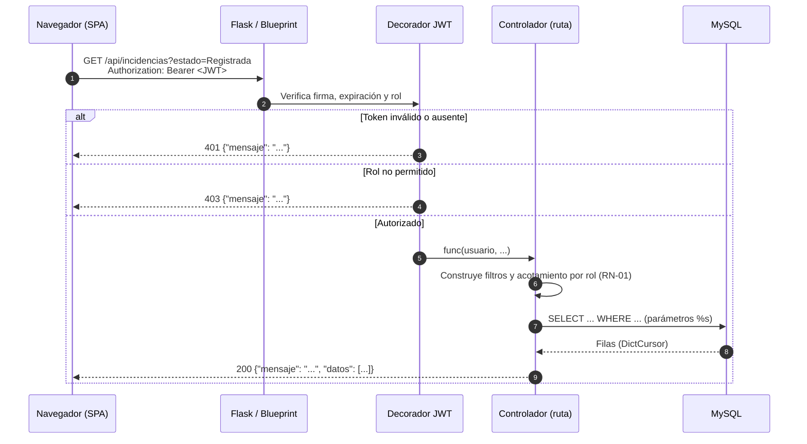
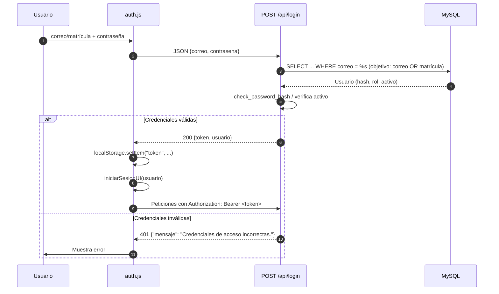
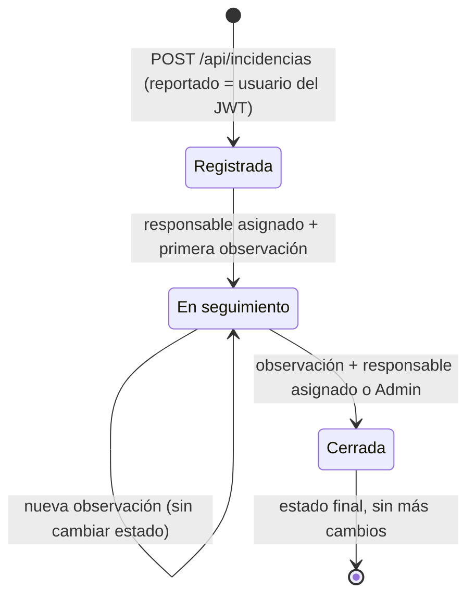

# Arquitectura

## 1. Visión general

El sistema implementa una **arquitectura MVC en tres capas** adaptada a una aplicación Flask + MySQL con frontend estático. No usa ORM: la capa de datos ejecuta SQL parametrizado con PyMySQL.

| Capa | Responsabilidad | Archivos actuales |
|---|---|---|
| **Presentación (Vista)** | Pantallas, formularios, navegación SPA, almacenamiento del JWT y consumo de la API | `frontend/index.html`, `frontend/css/styles.css`, `frontend/js/config.js`, `frontend/js/auth.js`, `frontend/js/app.js` |
| **Control (Controlador)** | Blueprints de Flask, validación de entrada, autorización por rol, orquestación de transacciones y respuestas JSON | `backend/app.py`, `backend/routes/auth.py`, `backend/routes/comunes.py`, `backend/routes/estudiantes.py`, `backend/routes/incidencias.py`, `backend/routes/usuarios.py`, `backend/routes/panel.py` |
| **Modelo / Datos** | Conexión a MySQL, cursores con diccionarios, SQL y persistencia | `backend/db.py` y el SQL embebido en las rutas |

El frontend es una **SPA simple**: `index.html` contiene todas las secciones y `navegarA()` en `app.js` oculta/muestra secciones con la clase `.hidden`. No hay router ni build.

## 2. Estructura de carpetas

```
backend/
  app.py                  # Crea Flask, CORS restringido, logging y blueprints
  config.py               # Configuración tipada desde backend/.env
  db.py                   # obtener_conexion_db() -> conexión PyMySQL utf8mb4
  scripts/
    migrar_contrasenas.py # Hashea contraseñas en texto plano (idempotente)
  routes/
    __init__.py
    auth.py               # Login + decorador de autorización
    comunes.py            # Validaciones, fechas, acotamiento RN-01 y SELECT base
    estudiantes.py        # Endpoints de estudiantes
    incidencias.py        # Endpoints de incidencias, asignación y bitácora
    usuarios.py           # Gestión de usuarios y selector de responsables
    panel.py              # Métricas del panel
frontend/
  index.html
  css/styles.css
  js/config.js            # const API_URL
  js/auth.js              # Login/logout y ajuste de UI por rol
  js/app.js               # Lógica de pantallas 2 a 6
```

> `routes/` es un paquete regular con `__init__.py` desde la Fase 1. Los helpers compartidos viven en `comunes.py` para no duplicar validaciones ni el acotamiento por rol.

## 3. Capa de presentación

- `auth.js` envía `POST /api/login`, guarda `token` y `usuario` en `localStorage`, y muestra/oculta la UI según `usuario.rol`.
- `app.js` construye las peticiones con el encabezado `Authorization: Bearer <token>`.
- `config.js` centraliza la URL base (`http://localhost:5000/api`).
- Limitaciones actuales: no restaura la sesión al recargar, usa `innerHTML` con datos del servidor, `onclick` con cadenas y no muestra errores del backend en la mayoría de los flujos.

## 4. Capa de control

`app.py` registra cinco blueprints:

```python
app.register_blueprint(auth_bp)
app.register_blueprint(estudiantes_bp)
app.register_blueprint(incidencias_bp)
app.register_blueprint(usuarios_bp)
app.register_blueprint(panel_bp)
```

Cada endpoint sigue este patrón:

1. Recibe JSON con `request.get_json()`.
2. Valida tipos, longitudes, ENUMs, fechas y existencia de referencias; responde `400/404/409` antes de escribir.
3. Abre una conexión con `obtener_conexion_db()`.
4. Ejecuta SQL parametrizado con `with conexion.cursor() as cursor`.
5. Hace `commit` o `rollback`.
6. Cierra la conexión en `finally`.
7. Responde JSON con la clave `mensaje`.

### Decorador de autorización

`requerir_token_y_rol(roles_permitidos=[...])` en `backend/routes/auth.py`:

1. Lee `Authorization`.
2. Extrae el token tras `Bearer `.
3. Decodifica y verifica la firma HS256 con `config.JWT_SECRET_KEY`.
4. Comprueba que `datos_usuario["rol"]` esté en `roles_permitidos` (si se especifica).
5. Inyecta el payload como **primer argumento** de la función protegida.

Códigos: `401` sin token/Token inválido/expirado; `403` rol sin permiso.

## 5. Capa de datos

`db.py` expone `obtener_conexion_db()` con:

- `cursorclass=DictCursor` → filas como diccionarios.
- `charset="utf8mb4"` → evita mojibake.
- `autocommit=False` → transacciones manuales.
- Parámetros `DB_HOST`, `DB_USER`, `DB_PASSWORD`, `DB_NAME`, `DB_PORT` leídos de `config.py` (`.env`).

No hay modelos/clases de dominio; las rutas contienen el SQL. Es un **Modelo Activo implícito** o *data mapper* ligero. Desde las fases 1 y 2 el SQL usa nombres de tabla en minúscula (`usuarios`, `estudiantes`, `incidencias`, `historial_seguimiento`).

## 6. Flujo de una petición

Ejemplo: listar incidencias (implementado en la Fase 2).



## 7. Flujo de autenticación



**Estado actual (Fase 2):** comparación con `check_password_hash`, búsqueda por correo o matrícula, rechazo de usuarios inactivos con `401` genérico y expiración UTC configurable. **Pendiente para la Fase 3:** restauración de sesión en el frontend validando el token y `401 → logout`.

## 8. Flujo del ciclo de vida (RN-03)



Reglas de implementación objetivo:

- `responsable` se asigna solo con `PUT /api/incidencias/<id>/responsable` (Admin) o al crear la incidencia (solo Administrador y Docente; si un Estudiante envía el campo, `403`).
- El seguimiento **nunca** modifica `responsable`.
- Toda transición/observación inserta una fila en `historial_seguimiento` con `usuario` y `fecha` (RN-04).

## 9. Decisiones y deuda técnica

| Tema | Estado actual | Objetivo |
|---|---|---|
| Configuración | `config.py` + `backend/.env` (Fase 1) | `.env` + `python-dotenv` |
| Contraseñas | `check_password_hash`; script de migración (Fase 1) | Hash Werkzeug |
| Tablas | Minúsculas en todo el SQL (Fase 1) | Minúsculas |
| Errores | `logging` + mensaje genérico (Fase 1) | `logging` + mensaje genérico |
| Autorización | Roles básicos; sin acotamiento por fila | RN-01 completo |
| Frontend | Sin restaurar sesión, XSS potencial | `fetchAPI`, escape/`textContent`, delegación de eventos |
| Pruebas | Ninguna | pytest por RN y rol |

Ver [REGLAS_DE_NEGOCIO.md](REGLAS_DE_NEGOCIO.md), [API.md](API.md) y [ROADMAP.md](ROADMAP.md).
