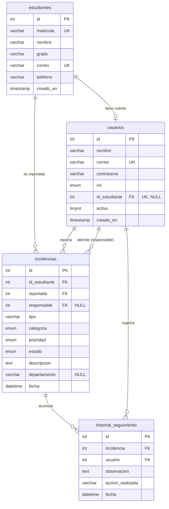

# Base de datos

Motor: **MySQL 8**, `InnoDB`, `utf8mb4` / `utf8mb4_unicode_ci`.

> El archivo `sistema_incidencias.sql` de la raíz es un **dump histórico dañado en codificación** ("Acad├®mica", "L├│pez"). No se usa como fuente ni debe importarse. La fuente de verdad es el DDL limpio de `backend/db/schema.sql` y la migración `backend/db/migraciones/001_roles_y_vinculos.sql`.

---

## 1. Esquema actual (tras la migración 001)

Los nombres de tabla se usan en **minúscula** en el DDL, la migración y todo el SQL del backend (normalizado en las fases 1 y 2): `usuarios`, `estudiantes`, `incidencias`, `historial_seguimiento`.

### `usuarios`

| Columna | Tipo | Restricciones |
|---|---|---|
| `id` | INT | PK, AUTO_INCREMENT |
| `nombre` | VARCHAR(100) | NOT NULL |
| `correo` | VARCHAR(100) | NOT NULL, UNIQUE |
| `contrasena` | VARCHAR(255) | NOT NULL (hash Werkzeug tras ejecutar el script de migración) |
| `rol` | ENUM('Administrador','Docente','Personal Responsable') | NOT NULL |
| `creado_en` | TIMESTAMP | NULL, DEFAULT CURRENT_TIMESTAMP |

### `estudiantes`

| Columna | Tipo | Restricciones |
|---|---|---|
| `id` | INT | PK, AUTO_INCREMENT |
| `matricula` | VARCHAR(20) | NOT NULL, UNIQUE |
| `nombre` | VARCHAR(100) | NOT NULL |
| `grado` | VARCHAR(20) | NOT NULL |
| `correo` | VARCHAR(100) | NOT NULL, UNIQUE |
| `telefono` | VARCHAR(20) | NULL |
| `creado_en` | TIMESTAMP | NULL, DEFAULT CURRENT_TIMESTAMP |

### `incidencias`

| Columna | Tipo | Restricciones |
|---|---|---|
| `id` | INT | PK, AUTO_INCREMENT |
| `id_estudiante` | INT | NOT NULL, FK → `estudiantes.id` ON DELETE CASCADE |
| `reportado` | INT | NOT NULL, FK → `usuarios.id` ON DELETE RESTRICT |
| `responsable` | INT | NULL, FK → `usuarios.id` ON DELETE SET NULL |
| `tipo` | VARCHAR(50) | NOT NULL |
| `categoria` | ENUM('Conducta','Académica','Asistencia','Otra') | NOT NULL |
| `prioridad` | ENUM('Baja','Media','Alta','Urgente') | DEFAULT 'Media' |
| `estado` | ENUM('Registrada','En seguimiento','Cerrada') | DEFAULT 'Registrada' |
| `descripcion` | TEXT | NOT NULL |
| `fecha` | DATETIME | DEFAULT CURRENT_TIMESTAMP |

### `historial_seguimiento`

| Columna | Tipo | Restricciones |
|---|---|---|
| `id` | INT | PK, AUTO_INCREMENT |
| `incidencia` | INT | NOT NULL, FK → `incidencias.id` ON DELETE CASCADE |
| `usuario` | INT | NOT NULL, FK → `usuarios.id` ON DELETE RESTRICT |
| `observacion` | TEXT | NOT NULL |
| `accion_realizada` | VARCHAR(100) | NOT NULL |
| `fecha` | DATETIME | DEFAULT CURRENT_TIMESTAMP |

### Datos actuales

- 7 usuarios: los 4 de desarrollo (`admin@cutonala.udg.mx` / `admin123` Administrador, `gabriel.navarro@cutonala.udg.mx` / `docente123` Docente, `ana.torres@cutonala.udg.mx` / `resp123` Personal Responsable y `jocelyn.silva@alumnos.udg.mx` / matrícula `219876543` / `estudiante123` Estudiante, id 4, `id_estudiante = 1`) más 3 cuentas de prueba de la Fase 2 (ids 5, 6 y 7). Todos con `activo = 1`.
- Las contraseñas están hasheadas con Werkzeug (`scrypt:`) tras ejecutar `backend/scripts/migrar_contrasenas.py`.
- 3 estudiantes: matrícula `219876543` (Jocelyn Citlalli Silva Diaz, 6to Semestre), `219112233` (Carlos Eduardo López, 4to Semestre) y `TEST-001` (Alumno Prueba, id 3, creado por las pruebas de la Fase 2).
- 3 incidencias: id 1 (semilla, reportada por usuario 2, responsable 3, `Registrada`), id 3 (prueba, reportada por el usuario Estudiante 4, sin responsable, `Registrada`) e id 4 (prueba, reportada por el usuario 2, responsable 3, `Cerrada`).
- `historial_seguimiento`: 3 filas de la incidencia 4 (asignación de responsable, transición a `En seguimiento` y cierre).

#### Datos de prueba de la Fase 2 (conservados)

El desarrollador pidió conservarlos para revisarlos en la Fase 3.

| Tipo | IDs | Detalle |
|---|---|---|
| Estudiante | 3 | `TEST-001` / `alumno.prueba@alumnos.udg.mx` |
| Usuario Docente | 5 | `usuario.prueba@cutonala.udg.mx` / `contrasenaSegura123` |
| Usuario Estudiante | 6 | `estudiante.prueba@alumnos.udg.mx` / `contrasenaSegura123`, vinculado al estudiante 3 |
| Usuario Personal Responsable | 7 | `responsable.prueba@cutonala.udg.mx` / `contrasenaSegura123` |
| Incidencia | 3 | Reportada por el usuario 6 (Estudiante), estado `Registrada` |
| Incidencia | 4 | Reportada por el usuario 2, responsable 3, estado `Cerrada`, con 3 filas de bitácora |

> Si en el futuro se desea limpiar, el orden seguro es: borrar `historial_seguimiento` de las incidencias 3 y 4, luego las incidencias 3 y 4, después los usuarios 5, 6 y 7 y finalmente el estudiante 3. Requiere confirmación explícita del desarrollador por ser SQL destructivo. No se reinicia `AUTO_INCREMENT`.

---

## 2. Esquema vigente (migración 001 aplicada)

Cambios aditivos:

| Tabla | Cambio | Motivo |
|---|---|---|
| `usuarios` | Nuevo valor `'Estudiante'` en `rol` | Decisión 1 |
| `usuarios` | `id_estudiante INT NULL UNIQUE` + FK → `estudiantes.id` ON DELETE RESTRICT | Vincular cuenta de estudiante |
| `usuarios` | `activo TINYINT(1) NOT NULL DEFAULT 1` | Impedir login de inactivos |
| `incidencias` | `departamento VARCHAR(100) NULL` | Pantalla 4 / decisión 2 |
| Varias | Índices de consulta | Rendimiento de filtros y panel |

### `usuarios` (objetivo)

| Columna | Tipo | Restricciones |
|---|---|---|
| `id` | INT | PK, AUTO_INCREMENT |
| `nombre` | VARCHAR(100) | NOT NULL |
| `correo` | VARCHAR(100) | NOT NULL, UNIQUE |
| `contrasena` | VARCHAR(255) | NOT NULL (hash Werkzeug) |
| `rol` | ENUM('Administrador','Docente','Personal Responsable','Estudiante') | NOT NULL |
| `id_estudiante` | INT | NULL, UNIQUE, FK → `estudiantes.id` **ON DELETE RESTRICT** |
| `activo` | TINYINT(1) | NOT NULL, DEFAULT 1 |
| `creado_en` | TIMESTAMP | NULL, DEFAULT CURRENT_TIMESTAMP |

La obligatoriedad de `id_estudiante` cuando `rol = 'Estudiante'` se valida en la **aplicación** (implementado en la Fase 2: `POST /api/usuarios`). No se agrega `CHECK` para mantener la migración compatible y re-ejecutable en MySQL 8.

### `incidencias` (objetivo)

Igual que el esquema actual más:

| Columna | Tipo | Restricciones |
|---|---|---|
| `departamento` | VARCHAR(100) | NULL |

### `estudiantes` y `historial_seguimiento`

Sin cambios estructurales.

---

## 3. Diagrama entidad-relación



---

## 4. Índices

### Existentes (creados por PK, UNIQUE y FKs)

| Tabla | Índice | Columnas |
|---|---|---|
| `usuarios` | PRIMARY | `id` |
| `usuarios` | `correo` (UNIQUE) | `correo` |
| `estudiantes` | PRIMARY | `id` |
| `estudiantes` | `matricula` (UNIQUE) | `matricula` |
| `estudiantes` | `correo` (UNIQUE) | `correo` |
| `incidencias` | PRIMARY | `id` |
| `incidencias` | `id_estudiante` | `id_estudiante` |
| `incidencias` | `reportado` | `reportado` |
| `incidencias` | `responsable` | `responsable` |
| `historial_seguimiento` | PRIMARY | `id` |
| `historial_seguimiento` | `incidencia` | `incidencia` |
| `historial_seguimiento` | `usuario` | `usuario` |

### Sugeridos (migración 001)

| Nombre | Tabla | Columnas | Uso |
|---|---|---|---|
| `ux_usuarios_id_estudiante` | `usuarios` | `id_estudiante` UNIQUE | Una cuenta por estudiante |
| `idx_usuarios_rol_activo` | `usuarios` | `rol`, `activo` | Selector de responsables y login |
| `idx_incidencias_estado_fecha` | `incidencias` | `estado`, `fecha` | Filtro por estado + recientes |
| `idx_incidencias_categoria_prioridad` | `incidencias` | `categoria`, `prioridad` | Filtros combinados |
| `idx_incidencias_fecha` | `incidencias` | `fecha` | Rangos `desde`/`hasta` y panel |
| `idx_historial_incidencia_fecha` | `historial_seguimiento` | `incidencia`, `fecha` | Cronología del detalle |

> `responsable` y `reportado` ya tienen índice por las claves foráneas; no se duplican. Para el acotamiento por rol (`reportado = ?`, `responsable = ?`) esos índices son suficientes.

---

## 5. Migración 001 — `001_roles_y_vinculos.sql`

Ubicación: `backend/db/migraciones/001_roles_y_vinculos.sql`.

Contenido funcional:

1. `USE sistema_incidencias;` y `SET NAMES utf8mb4;`.
2. `ALTER TABLE usuarios MODIFY COLUMN rol ENUM(...4 valores...) NOT NULL;` (re-ejecutable sin error).
3. Procedimiento temporal `sp_agregar_columna_si_no_existe` para añadir:
   - `usuarios.id_estudiante INT NULL` después de `rol`.
   - `usuarios.activo TINYINT(1) NOT NULL DEFAULT 1` después de `contrasena`.
   - `incidencias.departamento VARCHAR(100) NULL` después de `responsable`.
4. Procedimiento temporal `sp_crear_indice_si_no_existe` para crear índices/UNIQUE solo si faltan.
5. Procedimiento temporal `sp_agregar_fk_si_no_existe` para crear la FK `fk_usuarios_estudiante` solo si falta.
6. Eliminación de los procedimientos temporales.
7. Consultas de verificación (`SHOW COLUMNS`, `SHOW INDEX`, `information_schema`).

La migración **no** inserta, actualiza ni elimina datos. No cambia contraseñas: para eso se usa `backend/scripts/migrar_contrasenas.py` (ver siguiente sección).

### Cómo aplicarla

**Respaldo previo (obligatorio):**

```powershell
mysqldump -u root -p --result-file=respaldo_antes_001.sql sistema_incidencias
```

Si `mysqldump` no está en el `PATH`, usar *Server → Data Export* de MySQL Workbench.

**Desde MySQL Workbench:** abrir el archivo y ejecutarlo completo.

**Desde PowerShell (si `mysql` está en el `PATH`):**

```powershell
cmd /c "mysql -u root -p sistema_incidencias < backend\db\migraciones\001_roles_y_vinculos.sql"
```

> Se usa `cmd /c` porque PowerShell no admite el operador `<` de la misma forma y la codificación de la tubería puede alterar acentos. `cmd /c` pasa el archivo tal cual al cliente MySQL.

**Verificación:**

```sql
USE sistema_incidencias;
SHOW COLUMNS FROM usuarios;
SHOW COLUMNS FROM incidencias;
SHOW INDEX FROM usuarios WHERE Key_name = 'ux_usuarios_id_estudiante';
SELECT CONSTRAINT_NAME, TABLE_NAME, REFERENCED_TABLE_NAME
FROM information_schema.TABLE_CONSTRAINTS
WHERE CONSTRAINT_SCHEMA = 'sistema_incidencias'
  AND CONSTRAINT_NAME = 'fk_usuarios_estudiante';
```

Resultado esperado: `rol` incluye `Estudiante`; existen `id_estudiante` y `activo`; `incidencias.departamento` existe; el índice único y la FK aparecen.

### Re-ejecución

- `MODIFY COLUMN rol` es idempotente.
- Columnas, índices y FK se crean solo si no existen.
- No hay `DROP TABLE`, `TRUNCATE` ni `DELETE`.

### Reversión

No se incluye script de rollback porque eliminar columnas/FK podría perder datos. Si se necesita revertir, restaurar el respaldo:

```powershell
cmd /c "mysql -u root -p sistema_incidencias < respaldo_antes_001.sql"
```

---

## 6. Script de migración de contraseñas

`backend/scripts/migrar_contrasenas.py` convierte las contraseñas en texto plano de `usuarios` a hashes Werkzeug (`scrypt`). Es **idempotente**: solo modifica las que no empiezan por `scrypt:`, `pbkdf2:` o `argon2`; volver a ejecutarlo no altera las ya migradas. No imprime contraseñas ni hashes.

**Respaldo previo (obligatorio):**

```powershell
mysqldump -u root -p --result-file=respaldo_antes_contrasenas.sql sistema_incidencias
```

Si `mysqldump` no está en el `PATH`, exportar desde MySQL Workbench (*Server → Data Export*).

**Ejecución (desde `backend/`):**

```powershell
cd backend
python scripts\migrar_contrasenas.py --dry-run   # simulación, no escribe
python scripts\migrar_contrasenas.py             # migra las contraseñas
```

**Usuario Estudiante de desarrollo (opcional):** con `--crear-estudiante` inserta, solo si no existe, una cuenta con rol `Estudiante` vinculada al estudiante `id=1` y contraseña de desarrollo documentada en el README. Sin esa bandera el script no inserta usuarios.

```powershell
python scripts\migrar_contrasenas.py --crear-estudiante
```

---

## 7. `schema.sql` (instalación nueva)

`backend/db/schema.sql`:

- Crea `sistema_incidencias` con `utf8mb4_unicode_ci`.
- Usa `CREATE TABLE IF NOT EXISTS` (no destructivo).
- Define el esquema final completo con nombres en minúscula.
- Inserta datos semilla con acentos correctos y contraseñas **hasheadas** con Werkzeug.
- Incluye un cuarto usuario de desarrollo con rol `Estudiante`, vinculado al estudiante 1, para probar el rol.

> Para una base que ya existe con el esquema viejo, usar **solo** la migración 001. `schema.sql` no convierte tablas existentes; está pensado para instalaciones nuevas.

### Semilla de desarrollo en `schema.sql`

| Rol | Correo / matrícula | Contraseña (dev) |
|---|---|---|
| Administrador | `admin@cutonala.udg.mx` | `admin123` |
| Docente | `gabriel.navarro@cutonala.udg.mx` | `docente123` |
| Personal Responsable | `ana.torres@cutonala.udg.mx` | `resp123` |
| Estudiante | `jocelyn.silva@alumnos.udg.mx` / `219876543` | `estudiante123` |

Los hashes se generaron con `werkzeug.security.generate_password_hash` (Werkzeug 3.0.1, método `scrypt`). Son válidos para `check_password_hash`.

> El login (Fase 1) ya usa `check_password_hash`. Las bases existentes con contraseñas en texto plano deben ejecutar `backend/scripts/migrar_contrasenas.py` una vez.

---

## 8. Consideraciones

- **Zona horaria:** `DATETIME`/`TIMESTAMP` no guardan zona. MySQL usa la hora local del servidor para `fecha`; el JWT usa UTC (`datetime.now(timezone.utc)`) para `exp`, según la decisión de diseño.
- **Codificación:** todas las conexiones PyMySQL usan `charset="utf8mb4"` desde la Fase 1 para evitar mojibake como el del dump.
- **Integridad:** `ON DELETE CASCADE` en incidencias al borrar estudiante; `RESTRICT` en `reportado`, `historial.usuario` y `usuarios.id_estudiante` (no se puede borrar un estudiante con cuenta vinculada); `SET NULL` en `responsable`.
- **Auditoría:** `historial_seguimiento` no debe actualizarse ni borrarse desde la API (solo INSERT). No hay endpoint de borrado.
