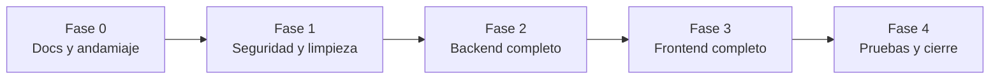

# Roadmap y plan de trabajo

Proyecto: Sistema de Gestión de Incidencias Escolares (Act. 17).
Estado: **Fase 2 entregada** (backend funcional completo). La Fase 3 (frontend) y la Fase 4 (pruebas) están pendientes de ejecución.

Leyenda: `- [x]` hecho · `- [ ]` pendiente.

> **Reglas de trabajo:** el proyecto no usa control de versiones. Antes de cada fase el desarrollador copia la carpeta del proyecto como respaldo; al terminar, el agente lista exactamente los archivos creados, modificados y eliminados.

---

## 0. Hallazgos verificados (deben quedar cubiertos)

| # | Hallazgo | Evidencia en el código | Fase |
|---|---|---|---|
| 1 | El frontend llama a `GET /api/incidencias`, que no existe | `frontend/js/app.js:14`; en `backend/routes/incidencias.py` solo hay POST | 2 |
| 2 | El frontend lee `data.message` pero el backend devuelve `mensaje` | `frontend/js/auth.js:21`; `backend/routes/auth.py:94,143` | 1-3 |
| 3 | Contraseñas en texto plano | `backend/routes/auth.py:112`; semilla del dump | 1 |
| 4 | Secretos hardcodeados y `config.py` vacío | `auth.py:23` (`LLAVE_SECRETA_JWT`), `db.py:12-15`; `config.py` = 0 bytes | 1 |
| 5 | Formulario de estudiantes sin `telefono` ni handler | `frontend/index.html:53-61`; no hay listener de `form-estudiante` en `app.js` | 3 |
| 6 | Sin restauración de sesión al recargar | `frontend/js/auth.js` solo escucha el submit; no valida token al cargar | 3 |
| 7 | `innerHTML` sin escapar (XSS) y `onclick` con comillas | `app.js:27-39, 53, 89-94` | 3 |
| 8 | Rol `Estudiante` inexistente | ENUM de `usuarios`; `auth.py`; `index.html:17` usa `type="email"` | 1-2 |
| 9 | Sin gestión de usuarios ni asignación de responsable | No existe `routes/usuarios.py` ni `PUT .../responsable` | 2 |
| 10 | RN-01 y RN-03 incompletas | `incidencias.py:119-142`; no hay consultas acotadas por rol | 2 |
| 11 | El `UPDATE` de seguimiento pisa `responsable` | `backend/routes/incidencias.py:137-142` | 2 |
| 12 | CORS abierto y `debug=True` | `backend/app.py:9` (`CORS(app)`), `app.py:17` | 1 |
| 13 | Fecha sin hora en el frontend | `frontend/js/app.js:34` (`toLocaleDateString()`) | 3 |
| 14 | Badge de "En seguimiento" sin estilo | `app.js:33` genera `badge-Enseguimiento`; `styles.css:89` define `.badge-Seguimiento` | 3 |
| 15 | `.pyc` / `__pycache__` en el proyecto | `backend/__pycache__/`, `backend/routes/__pycache__/` (4 `.pyc`) | 1 |
| 16 | Sin pruebas automatizadas | No existe carpeta `tests/` | 4 |

### Hallazgos adicionales detectados en la auditoría

| # | Hallazgo | Evidencia | Fase |
|---|---|---|---|
| 17 | `GET /api/estudiantes` no cierra conexión en `finally` ni maneja errores | `routes/estudiantes.py:11-16` | 1 |
| 18 | `POST /api/estudiantes` usa `data['...']` y filtra `str(e)` | `routes/estudiantes.py:29,34` | 1-2 |
| 19 | Conexión PyMySQL sin `charset="utf8mb4"` | `backend/db.py:30-38` | 1 |
| 20 | `datetime.utcnow()` obsoleto y sin zona | `routes/auth.py:114` | 1 |
| 21 | `routes/` sin `__init__.py` | listado de `backend/routes/` | 1 |
| 22 | El frontend no maneja respuestas no JSON (404 HTML) | `app.js:21` (`res.json()` directo) | 3 |
| 23 | Login con `input type="email"` impide usar matrícula | `index.html:17` | 3 |
| 24 | `GET /api/estudiantes` y login 200 no incluyen `mensaje` | `estudiantes.py:16`; `auth.py:132-140` | 1-2 |
| 25 | Tabla de estudiantes no muestra `telefono` | `index.html:66` | 3 |
| 26 | `requirements.txt` no incluye `python-dotenv` (Fase 1) ni `pytest` (Fase 4) | `backend/requirements.txt` | 1, 4 |
| 27 | Dump `sistema_incidencias.sql` dañado en codificación | "Acad├®mica", "L├│pez" | 0 (documentado) |
| 28 | Sin control de versiones | Se trabaja con respaldo manual de la carpeta por fase | 0 |

> **Resueltos en la Fase 1:** 3, 4, 12, 15, 17, 18, 19, 20, 21, 24 y la parte de `python-dotenv` del 26. El hallazgo 2 se completa en la Fase 3 (frontend).
>
> **Resueltos en la Fase 2:** 1, 8, 9, 10, 11, 18 y el resto del 24. Los hallazgos de frontend (2, 5, 6, 7, 13, 14, 22, 23, 25) quedan para la Fase 3; 16 y `pytest` del 26 para la Fase 4.

---

## Fase 0 — Documentación y andamiaje ✅

- [x] Explorar todo el código y el dump sin usarlo como fuente.
- [x] Crear `AGENTS.md` con stack, estructura, comandos, convenciones y decisiones.
- [x] Crear `README.md` con instalación, credenciales de desarrollo y estado.
- [x] Crear `docs/ARQUITECTURA.md` con MVC, flujos y diagramas Mermaid.
- [x] Crear `docs/API.md` con la API actual y el contrato objetivo.
- [x] Crear `docs/BASE_DE_DATOS.md` con esquema actual/objetivo, ER e índices.
- [x] Crear `docs/REGLAS_DE_NEGOCIO.md` con RN-01..04 y matriz Rol × Acción.
- [x] Crear `docs/ROADMAP.md`.
- [x] Crear `backend/db/schema.sql` y `backend/db/migraciones/001_roles_y_vinculos.sql`.
- [x] Crear `backend/.env.example`.
- [x] No modificar archivos de código existentes.

**Aceptación:** documentación coherente con el código, migración no destructiva y esquema reproducible. **Cumplido.**

---

## Fase 1 — Seguridad base y limpieza del backend ✅

Objetivo: eliminar secretos y contraseñas en texto plano, centralizar configuración y dejar el backend consistente antes de añadir funcionalidad.

### 1.1 Configuración por entorno

- [x] Crear `backend/config.py` con variables que lean `os.environ`.
- [x] Añadir `python-dotenv==1.0.1` a `backend/requirements.txt` (justificación: cargar `.env` sin exportar variables manualmente).
- [x] Cargar `.env` desde `backend/config.py` con `load_dotenv()` al importar la configuración.
- [x] Mover `DB_HOST`, `DB_PORT`, `DB_USER`, `DB_PASSWORD`, `DB_NAME`, `SECRET_KEY`, `JWT_SECRET_KEY`, `JWT_EXPIRACION_HORAS`, `FLASK_DEBUG` y `CORS_ORIGINS` a configuración.
- [x] `db.py` lee de `config.py` y usa `charset="utf8mb4"`.
- [x] `app.py`: `CORS(app, origins=config.CORS_ORIGINS)` y `debug` desde configuración.
- [x] Eliminar `LLAVE_SECRETA_JWT` hardcodeada de `auth.py`.

**Archivos:** `backend/config.py`, `backend/app.py`, `backend/db.py`, `backend/routes/auth.py`, `backend/requirements.txt`, `backend/.env.example`, `backend/.env` (local, no se comparte).
**Aceptación:** el backend arranca solo con `.env`; no hay credenciales ni claves en el código; CORS limitado a los orígenes configurados; `debug` desactivable. **Cumplido.**

### 1.2 Contraseñas seguras

- [x] Usar `check_password_hash` en el login. `generate_password_hash` al crear usuarios se aplicará en la Fase 2, cuando exista el endpoint de alta.
- [x] Crear `backend/scripts/migrar_contrasenas.py`: detecta contraseñas que no empiezan por un prefijo de hash conocido (`scrypt:`, `pbkdf2:`, `argon2`) y las reemplaza por su hash; idempotente; imprime resumen; no imprime contraseñas.
- [x] Documentar el script y su ejecución en `README.md` y `docs/BASE_DE_DATOS.md`.

**Archivos:** `backend/routes/auth.py`, `backend/scripts/migrar_contrasenas.py` (nuevo), `backend/requirements.txt` (Werkzeug ya está).
**Aceptación:** login funciona con contraseñas hasheadas; ejecutar el script dos veces no altera hashes ya migrados; la BD existente queda con hashes. **Cumplido** (script ejecutado: 3 contraseñas migradas y 4 usuarios con hash `scrypt:`).

### 1.3 Login por correo o matrícula y usuarios activos

- [x] `POST /api/login` busca por `correo` o por matrícula del estudiante vinculado (`LEFT JOIN estudiantes`).
- [x] Rechazar `activo = 0` con `401` genérico.
- [x] Incluir `id_estudiante` en el JWT y en `usuario`.
- [x] Mantener el campo `correo` por compatibilidad (acepta correo o matrícula).
- [x] Reemplazar `datetime.utcnow()` por `datetime.now(timezone.utc)`.

**Archivos:** `backend/routes/auth.py`.
**Aceptación:** admin/docente/responsable entran con correo; estudiante entra con correo o matrícula; usuario inactivo recibe 401; token con expiración correcta. **Cumplido.**

### 1.4 Contrato JSON y errores

- [x] Unificar `mensaje` en todas las respuestas (incluido login 200 y `GET /api/estudiantes`).
- [x] Reemplazar `message` en `estudiantes.py`.
- [x] Quitar `str(e)` / `detalle` de todos los 500 y registrar con `logging.exception`.
- [x] Añadir `logging` configurado en `app.py`.
- [x] Validar JSON: cuerpo ausente/no objeto → 400; campos obligatorios y tipos; ENUMs en Fase 2.
- [x] Normalizar nombres de tablas a minúscula en todo el SQL (`usuarios`, `estudiantes`, `incidencias`, `historial_seguimiento`).
- [x] Añadir `backend/routes/__init__.py`.
- [x] Usar `with conexion.cursor()` y `finally: conexion.close()` en todas las rutas.
- [x] No incluir artefactos generados (`__pycache__`, `.pyc`) en el respaldo del proyecto.

**Archivos:** `backend/routes/auth.py`, `backend/routes/estudiantes.py`, `backend/routes/incidencias.py`, `backend/routes/__init__.py` (nuevo), `backend/app.py`.
**Aceptación:** todas las respuestas tienen `mensaje`; ningún 500 devuelve detalles internos; el SQL usa minúsculas; no quedan conexiones sin cerrar; `python -m compileall backend` sin errores. **Cumplido.**

### 1.5 Documentación de la fase

- [x] Actualizar `docs/API.md` (login, respuestas, errores) y `docs/BASE_DE_DATOS.md` (charset, script de contraseñas).
- [x] Marcar esta fase en `docs/ROADMAP.md`.

**Aceptación:** docs reflejan el comportamiento real y las pruebas manuales están documentadas. **Cumplido.**

---

## Fase 2 — Backend funcional completo ✅

Objetivo: implementar todos los endpoints del contrato objetivo y las reglas RN-01..04.

### 2.0 Migración

- [x] Confirmar con el usuario el respaldo de la BD.
- [x] Aplicar `backend/db/migraciones/001_roles_y_vinculos.sql` (confirmado por el desarrollador antes de la Fase 1).
- [x] Verificar columnas, índice único y FK (confirmado: existen `id_estudiante`, `activo`, `departamento` y el ENUM incluye `Estudiante`).
- [x] Crear el usuario Estudiante de desarrollo (creado con `migrar_contrasenas.py --crear-estudiante`: id 4, vinculado al estudiante 1).

**Archivos:** `backend/db/migraciones/001_roles_y_vinculos.sql`, `docs/BASE_DE_DATOS.md`.
**Aceptación:** el esquema tiene `rol='Estudiante'`, `id_estudiante`, `activo` y `departamento`; la migración se puede re-ejecutar sin error.

### 2.1 Listado de incidencias

- [x] `GET /api/incidencias` con `q`, `estudiante`, `categoria`, `prioridad`, `estado`, `responsable`, `desde`, `hasta`.
- [x] Acotamiento por rol (RN-01): Admin todo; Docente/Estudiante `reportado`; Responsable `responsable`.
- [x] JOIN con estudiantes y usuarios para nombres; orden `fecha DESC, id DESC`.
- [x] Validar ENUMs y fechas; `400` si son inválidos.
- [x] Respuesta `{mensaje, total, datos}`.

**Archivos:** `backend/routes/incidencias.py`, `docs/API.md`.
**Aceptación:** cada rol ve solo lo permitido; los filtros combinados funcionan; un Docente no ve incidencias de otro; un Estudiante no ve las de otros.

### 2.2 Detalle y bitácora

- [x] `GET /api/incidencias/<id>` con datos generales.
- [x] `bitacora_visible` + `bitacora` solo para Admin y responsable asignado.
- [x] Quien reportó ve datos generales y estado, sin bitácora.
- [x] `404` si no existe o no es visible para el rol.
- [x] Orden cronológico ascendente de la bitácora.

**Archivos:** `backend/routes/incidencias.py`, `docs/API.md`.
**Aceptación:** Admin y responsable ven observaciones; Docente/Estudiante no; un Responsable no asignado recibe 404.

### 2.3 Registro de incidencias

- [x] Añadir `departamento` y `responsable` opcional al `POST /api/incidencias`.
- [x] Permitir rol Estudiante (solo para su propio `id_estudiante`).
- [x] Validar ENUMs, longitudes, existencia de estudiante y que el responsable sea activo con rol `Personal Responsable`.
- [x] Aceptar `responsable` solo de Administrador y Docente; si lo envía un Estudiante, responder `403`.
- [x] Mantener `reportado` del JWT y estado `Registrada` (RN-02/RN-03).
- [x] `403` si un Estudiante intenta reportar a otro o no tiene vínculo.

**Archivos:** `backend/routes/incidencias.py`, `docs/API.md`.
**Aceptación:** se crea con y sin responsable/departamento; valores inválidos dan 400/404, nunca 500; `reportado` no se puede falsificar; un Estudiante que envía `responsable` recibe 403.

### 2.4 Asignación de responsable

- [x] `PUT /api/incidencias/<id>/responsable` solo Admin.
- [x] Validar usuario activo con rol `Personal Responsable`.
- [x] Rechazar incidencia `Cerrada` con 409.
- [x] Registrar la asignación en `historial_seguimiento` (RN-04).
- [x] No cambiar el estado.

**Archivos:** `backend/routes/incidencias.py`, `docs/API.md`, `docs/REGLAS_DE_NEGOCIO.md`.
**Aceptación:** solo Admin asigna; el selector de la Fase 3 obtiene los responsables activos; la asignación queda auditada.

### 2.5 Seguimiento y ciclo de vida

- [x] Corregir `agregar_seguimiento_bitacora()`: **no** tocar `responsable`.
- [x] Validar `nuevo_estado` contra `En seguimiento` / `Cerrada`; `400` si es inválido.
- [x] `Registrada → En seguimiento` exige responsable asignado y observación.
- [x] `Cerrada` exige estado `En seguimiento`; si ya está cerrada, `409`.
- [x] Solo el responsable asignado o Admin; Responsable no asignado → `404`.
- [x] Insertar historial con usuario y fecha (RN-04).

**Archivos:** `backend/routes/incidencias.py`, `docs/API.md`, `docs/REGLAS_DE_NEGOCIO.md`.
**Aceptación:** todas las transiciones de la tabla de API.md se cumplen; `responsable` permanece intacto; no se puede reabrir una incidencia cerrada.

### 2.6 Estudiantes

- [x] `GET /api/estudiantes` con `q` y `grado`.
- [x] Admin/Docente/Responsable: campos completos.
- [x] Estudiante: solo su registro con `id`, `nombre`, `matricula` (supuesto confirmado en la implementación).
- [x] `POST /api/estudiantes`: validar campos, correo, longitudes y `telefono`.
- [x] Duplicados de matrícula/correo → `409` con `mensaje` claro.
- [x] Cerrar conexión en `finally` y no filtrar errores.

**Archivos:** `backend/routes/estudiantes.py`, `docs/API.md`.
**Aceptación:** el formulario de la Fase 3 puede enviar teléfono; duplicados dan 409; el Estudiante no ve datos sensibles de otros.

### 2.7 Usuarios y responsables

- [x] `GET /api/usuarios` (Admin) con filtros `rol`, `activo`; sin `contrasena`.
- [x] `POST /api/usuarios` (Admin): hash, validación de rol, `id_estudiante` obligatorio para Estudiante, duplicados 409.
- [x] `PUT /api/usuarios/<id>/estado` (Admin): activar/desactivar; impedir autodesactivación.
- [x] `GET /api/responsables`: usuarios activos con rol `Personal Responsable`.

**Archivos:** `backend/routes/usuarios.py` (nuevo), `backend/app.py` (registrar blueprint), `docs/API.md`.
**Aceptación:** el Admin crea un usuario Estudiante vinculado; un inactivo no puede entrar; el selector devuelve solo responsables activos.

### 2.8 Métricas del panel

- [x] `GET /api/panel/metricas` con acotamiento por rol.
- [x] Totales por estado, prioridad y categoría (claves completas con 0).
- [x] 5 incidencias recientes ordenadas por fecha.

**Archivos:** `backend/routes/panel.py` (nuevo), `backend/app.py`, `docs/API.md`.
**Aceptación:** Admin ve totales globales; Docente/Estudiante solo sus reportes; Responsable solo sus asignadas.

### 2.9 Cierre de fase

- [x] Actualizar `docs/API.md`, `docs/BASE_DE_DATOS.md`, `docs/REGLAS_DE_NEGOCIO.md` y este roadmap.
- [x] Pruebas por rol (script con 88 comprobaciones: login, listados, detalle, filtros, altas, asignación, transiciones, usuarios y métricas).
- [x] Listar los archivos creados, modificados y eliminados al final de la fase (el respaldo de la carpeta lo realiza el desarrollador antes de la fase).

**Aceptación:** todos los endpoints del contrato responden con los códigos documentados; no hay 500 por datos de entrada inválidos.

---

## Fase 3 — Frontend completo

Objetivo: consumir el contrato objetivo, aplicar permisos visuales y eliminar XSS.

### 3.1 Sesión y API

- [ ] Restaurar sesión al recargar: leer token, verificar expiración local y validar con una petición autenticada; `401` → logout.
- [ ] Crear helper `fetchAPI(ruta, opciones)` con `Authorization`, `Content-Type`, parseo JSON y manejo central de errores.
- [ ] Mostrar `mensaje` del servidor en todos los formularios.
- [ ] `logout` limpia `localStorage` y vuelve al login.

**Archivos:** `frontend/js/auth.js`, `frontend/js/app.js`, `frontend/js/api.js` (nuevo, opcional), `frontend/js/config.js`.
**Aceptación:** recargar la página mantiene la sesión; token inválido/expirado vuelve al login; los errores se ven en pantalla.

### 3.2 Seguridad del DOM

- [ ] Reemplazar `innerHTML` con datos del servidor por `textContent` o una función `escaparHTML()`.
- [ ] Eliminar `onclick` con cadenas; usar `data-*` y delegación de eventos.
- [ ] Validar que nombres con comillas/etiquetas no rompen la tabla ni ejecutan scripts.

**Archivos:** `frontend/js/app.js`, `frontend/index.html`.
**Aceptación:** un nombre como `` se muestra como texto; no hay handlers inline con datos.

### 3.3 Pantalla 2 — Panel

- [ ] Consumir `GET /api/panel/metricas`.
- [ ] Tarjetas de totales por estado/prioridad/categoría.
- [ ] Tabla de 5 recientes con acceso al detalle.
- [ ] Adaptar el texto para Estudiante ("resumen de mis reportes").

**Archivos:** `frontend/index.html`, `frontend/js/app.js`, `frontend/css/styles.css`.
**Aceptación:** las métricas cambian según el rol y coinciden con la API.

### 3.4 Pantalla 3 — Estudiantes

- [ ] Añadir campo `telefono` al formulario y a la tabla.
- [ ] Handler de `form-estudiante` con validación y `fetchAPI`.
- [ ] Refrescar la tabla tras crear; mostrar 409/400.
- [ ] Ocultar el formulario de alta a quien no sea Admin.

**Archivos:** `frontend/index.html`, `frontend/js/app.js`, `frontend/css/styles.css`.
**Aceptación:** se crea un estudiante con teléfono; duplicados muestran mensaje; Docente/Estudiante no ven el alta.

### 3.5 Pantalla 4 — Formulario de incidencia

- [ ] Añadir `departamento` y selector de `responsable` (desde `GET /api/responsables`).
- [ ] Para Estudiante, ocultar el selector de estudiante y usar su propio vínculo.
- [ ] Para Estudiante, ocultar el selector de `responsable` (el backend rechaza el campo con `403`).
- [ ] Ocultar campos que no correspondan al rol.
- [ ] Validar y mostrar errores; limpiar y navegar al listado al crear.

**Archivos:** `frontend/index.html`, `frontend/js/app.js`.
**Aceptación:** Docente/Admin eligen estudiante y pueden indicar responsable; Estudiante no ve ninguno de los dos selectores y su petición no incluye `responsable`; se guarda departamento.

### 3.6 Pantalla 5 — Lista y filtros

- [ ] Buscador `q`.
- [ ] Filtros: estudiante, fecha desde/hasta, categoría, prioridad, responsable, estado.
- [ ] Construir query string solo con valores no vacíos.
- [ ] Mostrar fecha **con hora** (`toLocaleString`).
- [ ] Corregir badge: mapear `En seguimiento` → `badge-Seguimiento` (o renombrar la clase CSS).
- [ ] Mostrar mensaje si no hay resultados.

**Archivos:** `frontend/index.html`, `frontend/js/app.js`, `frontend/css/styles.css`.
**Aceptación:** los filtros combinados funcionan; Estudiante solo ve sus reportes; el badge "En seguimiento" tiene color.

### 3.7 Pantalla 6 — Detalle y seguimiento

- [ ] Consumir `GET /api/incidencias/<id>`.
- [ ] Cronología de bitácora con fecha **y hora**.
- [ ] Mostrar/ocultar bitácora según `bitacora_visible`.
- [ ] Selector de responsable y botón de asignación solo para Admin.
- [ ] Controles de estado solo para Admin/responsable asignado y según el estado actual.
- [ ] Ocultar el formulario de seguimiento a Docente/Estudiante.
- [ ] Recargar el detalle tras cada acción.

**Archivos:** `frontend/index.html`, `frontend/js/app.js`, `frontend/css/styles.css`.
**Aceptación:** Admin asigna responsable; el responsable agrega observaciones y cierra; el reportero ve estado y datos generales sin bitácora.

### 3.8 Gestión de usuarios (Admin)

- [ ] Nueva sección/pantalla de usuarios.
- [ ] Listar con filtros por rol/activo.
- [ ] Crear usuario (rol, `id_estudiante` cuando aplique, contraseña).
- [ ] Activar/desactivar.
- [ ] Mostrar solo a Admin en el menú.

**Archivos:** `frontend/index.html`, `frontend/js/app.js`, `frontend/css/styles.css`.
**Aceptación:** el Admin crea un Estudiante vinculado y lo desactiva; el usuario desactivado no puede entrar.

### 3.9 Menú, login y responsividad

- [ ] Cambiar el login a `input type="text"` con etiqueta "Correo o matrícula".
- [ ] Mostrar/ocultar botones y secciones según rol.
- [ ] Añadir menú de navegación coherente (Panel, Incidencias, Nueva, Estudiantes, Usuarios).
- [ ] Responsividad básica: tablas con scroll horizontal, grids a una columna en móvil, botones apilados.
- [ ] Revisar contraste y estados de foco.

**Archivos:** `frontend/index.html`, `frontend/css/styles.css`, `frontend/js/auth.js`, `frontend/js/app.js`.
**Aceptación:** un estudiante inicia sesión con matrícula; no ve acciones prohibidas; la interfaz es usable en 375 px y 1366 px.

### 3.10 Cierre de fase

- [ ] Actualizar `docs/API.md` si cambió algún contrato y `docs/REGLAS_DE_NEGOCIO.md`.
- [ ] Pruebas manuales por rol en el navegador.
- [ ] Actualizar el respaldo de la carpeta y listar los archivos creados, modificados y eliminados.

**Aceptación:** las seis pantallas del PDF están cubiertas y no queda ningún `onclick` con datos del servidor ni `innerHTML` sin escapar.

---

## Fase 4 — Pruebas y cierre

Objetivo: demostrar el cumplimiento de RN-01..04 y permisos con pruebas automatizadas.

### 4.1 Estrategia de pruebas

- [ ] Proponer al usuario una de estas opciones y esperar confirmación:
  - **A (recomendada):** base de datos de pruebas `sistema_incidencias_test` creada desde `schema.sql`, con fixtures que limpian datos entre pruebas.
  - **B:** mocks de `obtener_conexion_db()` con `unittest.mock` (sin MySQL real).
- [ ] Añadir `pytest==8.x` y `pytest-flask==1.x` a `requirements-dev.txt` (no a producción).
- [ ] Configurar `tests/conftest.py` con app de prueba, cliente y tokens por rol.

**Archivos:** `tests/` (nuevo), `backend/requirements-dev.txt` (nuevo), `pytest.ini` o `pyproject.toml`.
**Aceptación:** `pytest` corre en local y falla si se rompe una regla.

### 4.2 Cobertura mínima

- [ ] **RN-01:** sin token → 401; rol incorrecto → 403; Docente/Estudiante solo ven lo reportado; Responsable solo lo asignado; bitácora privada.
- [ ] **RN-02:** `reportado` ignorado del body; fecha y usuario correctos; no se puede alterar.
- [ ] **RN-03:** transiciones válidas e inválidas; cierre solo desde `En seguimiento`; `Cerrada` final; `responsable` no se sobrescribe.
- [ ] **RN-04:** cada observación y asignación crea historial con usuario y fecha.
- [ ] **Estudiantes:** duplicados 409; Estudiante solo campos mínimos.
- [ ] **Usuarios:** crear con rol Estudiante; inactivo no entra; autodesactivación bloqueada.
- [ ] **Login:** correo y matrícula; hash; token expirado.

**Aceptación:** todos los casos anteriores pasan; se reporta el porcentaje de cobertura de rutas.

### 4.3 Revisión final de seguridad

- [ ] Sin secretos en el proyecto; `.env` no se comparte ni se publica.
- [ ] `debug=False` por defecto en producción.
- [ ] CORS restringido.
- [ ] SQL 100 % parametrizado.
- [ ] Contraseñas hasheadas y nunca devueltas.
- [ ] Sin `str(e)` en respuestas.
- [ ] Sin XSS en el frontend.
- [ ] Dependencias con versiones fijas y revisadas.

**Aceptación:** checklist firmado en `docs/ROADMAP.md` y sin hallazgos críticos.

### 4.4 Documentación y entrega

- [ ] Actualizar `README.md`, `AGENTS.md`, `docs/ARQUITECTURA.md`, `docs/API.md`, `docs/BASE_DE_DATOS.md` y `docs/REGLAS_DE_NEGOCIO.md`.
- [ ] Marcar todos los ítems de las fases 1 a 4.
- [ ] Checklist de entrega: instalación desde cero, migración, credenciales, pruebas, capturas.
- [ ] Actualizar el respaldo de la carpeta y listar los archivos creados, modificados y eliminados.

**Aceptación:** un tercero puede instalar, ejecutar y probar el sistema siguiendo solo el README.

---

## Dependencias entre fases

- La migración 001 ya fue aplicada y verificada por el desarrollador antes de la Fase 1.
- El script de contraseñas de la Fase 1 requiere que el login ya use hashes.
- El frontend de la Fase 3 depende del contrato de la Fase 2.
- Las pruebas de la Fase 4 cubren lo construido en 1 a 3.

## Notas de ejecución

- **Sin control de versiones:** antes de cada fase el desarrollador copia la carpeta del proyecto como respaldo; al terminar, el agente lista exactamente los archivos creados, modificados y eliminados.
- **Aprobación:** al terminar cada fase, detenerse y esperar "continúa con la Fase N".
- **Esquema:** nunca ejecutar SQL destructivo ni tocar la BD sin confirmación explícita.
- **Dependencias:** cualquier alta debe justificarse y fijar versión.
